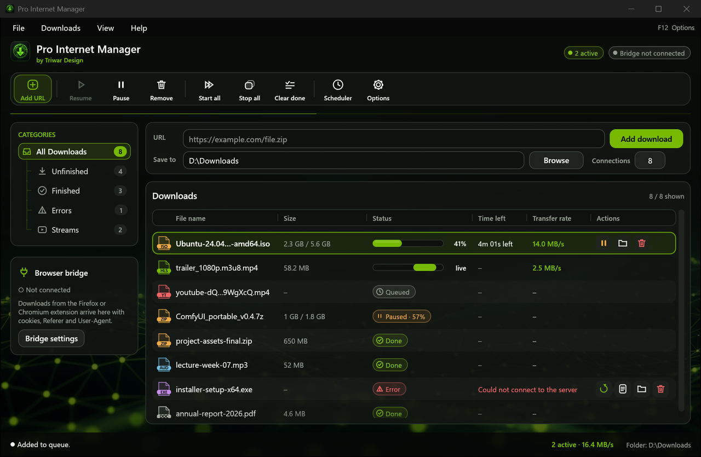
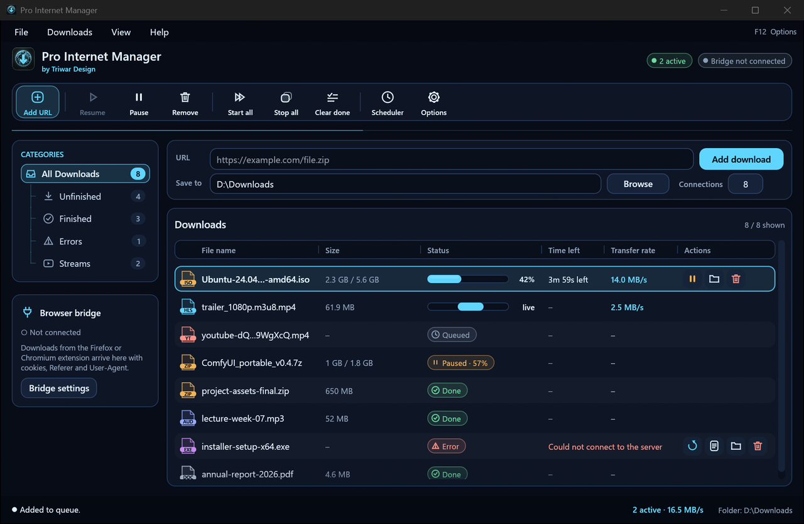
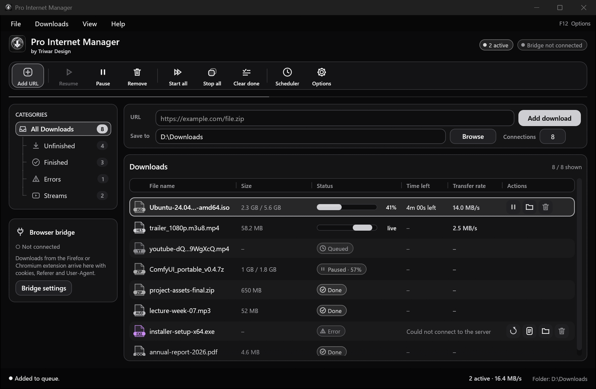
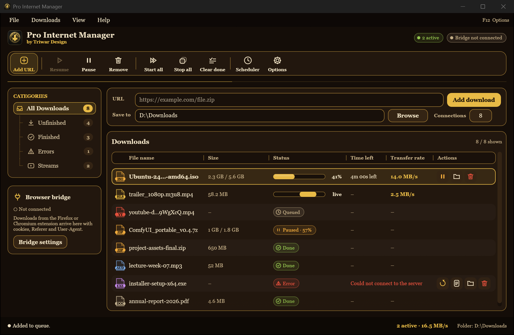
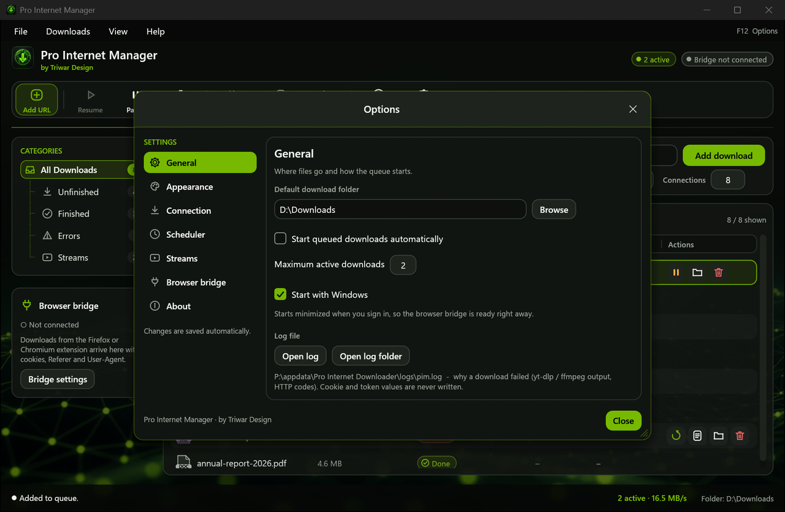
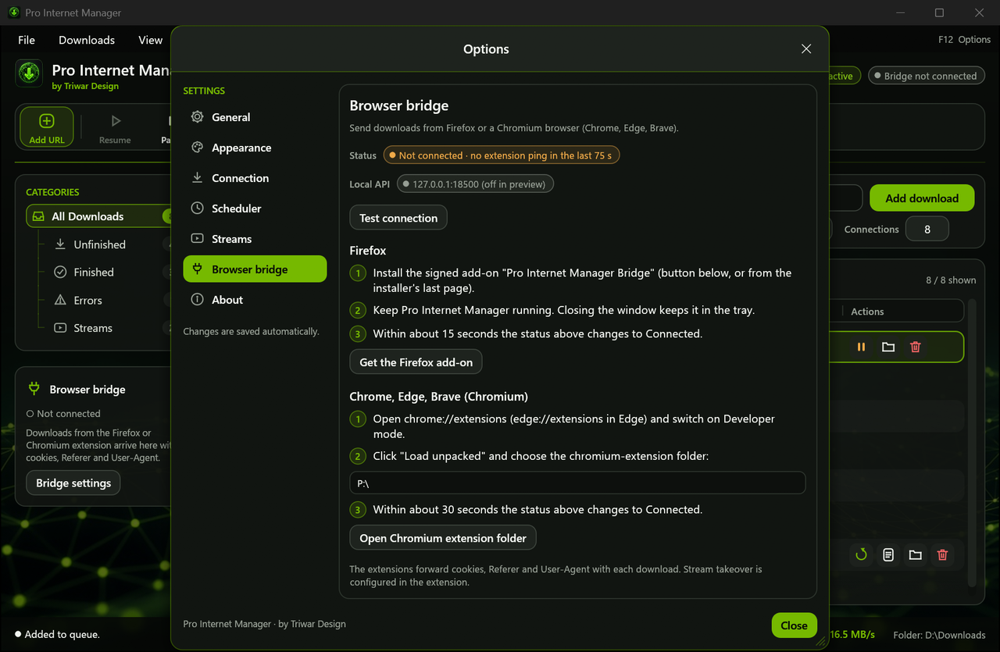
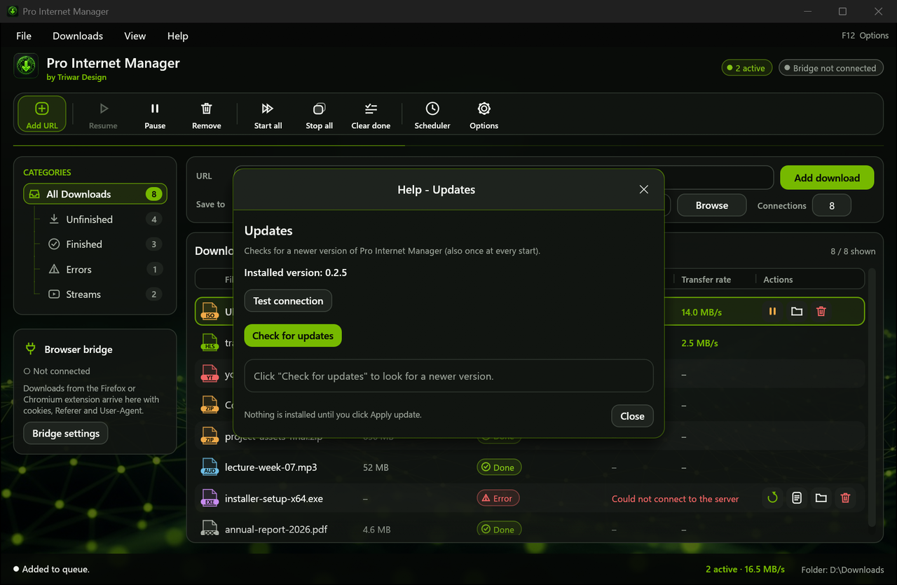
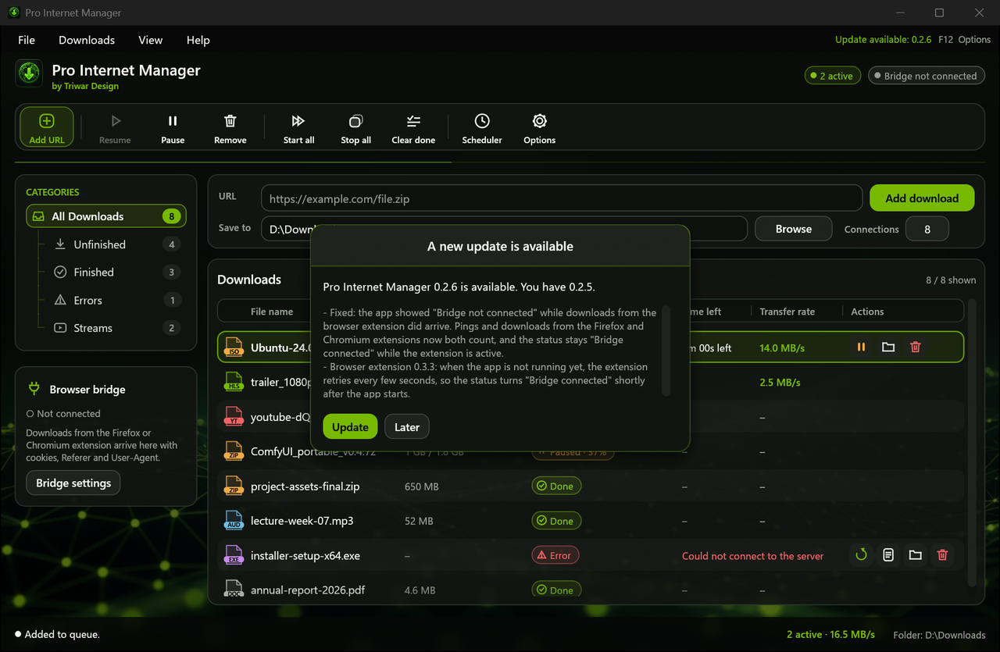
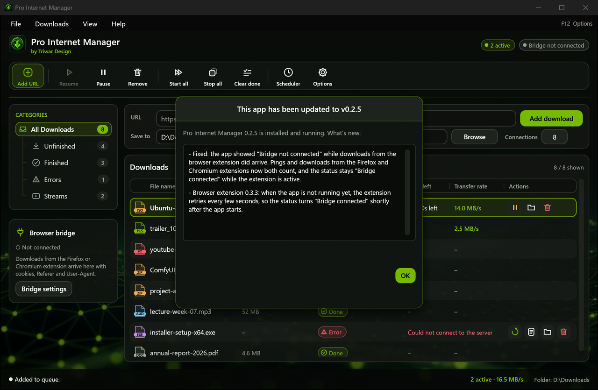

# Pro Internet Downloader

Pro Internet Manager (by Triwar Design) is a fast, modern download manager for Windows. It downloads regular files and videos from sites such as YouTube, and picks up links straight from your browser with the "Pro Internet Manager Bridge" extension. This repository only contains released installers, no source code.

## What it does

- Downloads files and videos (video downloads use yt-dlp and ffmpeg, with a bundled JavaScript runtime, so you never have to install anything yourself).
- Browser extension for Firefox and Chromium browsers (Chrome, Edge, Brave) that lists the downloadable sources on the page you are on, with type and quality.
- Download queue with progress, speed, time left and size, plus a scheduler.
- Four themes (Pro Lime, Midnight, Graphite, Azeroth) plus Paper and Compact.
- Closes to the system tray and keeps running in the background. Right-click the tray icon to open it or exit.
- Built-in update check under Help, with automatic patch updates and rollback if something goes wrong.
- A real log file so you can see why something failed.

## Screenshots

*Main window (Pro Lime theme) with sample downloads. Screenshots are taken in preview mode, so no browser is connected.*

| Midnight | Graphite | Azeroth |
| --- | --- | --- |
|  |  |  |

*Options > General: download folder, queue and log file.*

*Options > Browser bridge: connection status and setup steps for Firefox and Chromium browsers.*

*Help > Updates: installed version and update check.*

*The in-app prompt when a new version is available (preview).*

*After an update, the app shows once what changed.*

## Install

Download the installer from the Releases page and run it. The default location is `C:\Program Files\Pro Internet Manager` (Windows asks for permission once). The extension is an optional component in the installer.

## Patch notes

### 0.2.0
- New look and feel with themes, including a globe icon that follows the theme colour.
- Close to tray, single instance, start with Windows option.
- "Check for updates" under Help with download of the update.
- Log file with an "Open log" button, secrets are masked.
- yt-dlp and deno are handled automatically, with a cookie fix for the cookie errors.
- Installer in English with optional Firefox and Chromium extensions.

### 0.2.1
- Compact header and toolbar, bottom row always visible, scrollbar always visible.
- Completed downloads show the total size, long file names are shortened in the middle with a tooltip.
- Better contrast in every theme, status labels with icons.
- Row actions appear on hover or selection, and delete asks for confirmation.
- Empty list with "Paste URL from clipboard" and "Type a URL" buttons.
- "Bridge connected / not connected" label, with browser steps under Options.
- Scheduler fields are greyed out when the scheduler is off.
- Updates window shows clearly whether you are up to date and has an "Apply update" button.
- Patch updates with backup and automatic rollback.

### 0.2.2
- YouTube downloads show progress, size, time left and speed in the row, and the status bar shows the total speed. "Merging" is shown while video and audio are combined.
- Pause really stops a video download.
- "Test connection" button for the browser bridge and the update link.
- "Retry" button on failed downloads with a link to the log.
- yt-dlp keeps itself up to date automatically (can be switched off in Options).

### 0.2.3
- The app checks for updates once at every start and shows an in-app prompt when a new version is available.
- After an update, a window shows "This app has been updated" with a scrollable list of the fixes.
- Update links are never shown anywhere in the app, its messages or its log.
- The "Open update folder" button is removed from Help.
- Logs and settings now live in their own `Pro Internet Downloader` folder in AppData. Existing settings are copied over once.
- The uninstaller no longer touches the folder of the original Rust Download Manager.

### 0.2.4
- Fixed the browser bridge sometimes showing "not connected": a dropped browser connection could freeze the local connection to the extension. Every connection now has its own time limit.
- Starting the app while it is already running brings the existing window to the front instead of starting a second copy.
- Options always opens on the General tab.
- A leftover tray icon from an earlier session is cleaned up at start.

### 0.2.5
- Fixed the app showing "Bridge not connected" while downloads from the browser extension did arrive. Pings and downloads from the Firefox and Chromium extensions now both count, and the status stays "Bridge connected" while the extension is active.
